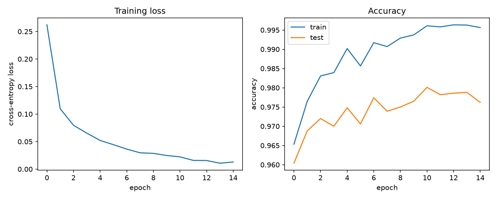

# nn-from-scratch

A neural network trained on real MNIST digits, built entirely on a
hand-written automatic differentiation engine — no PyTorch, no TensorFlow,
no autograd library. The point was to actually understand backpropagation,
not just call `.fit()`.

## What's in here

- `nn/engine.py` — a tiny reverse-mode autodiff engine. A `Tensor` wraps a
  NumPy array and records how it was produced (which operation, which
  parent tensors). Calling `.backward()` walks that computation graph
  backwards and accumulates gradients via the chain rule. This is the same
  idea as [micrograd](https://github.com/karpathy/micrograd), except it
  operates on NumPy arrays instead of individual scalars, which is what
  makes it fast enough to train on 60,000 real images instead of toy
  examples.
- `nn/layers.py` — `Linear`, `ReLU`, `Sequential`, and a numerically-stable
  `cross_entropy_loss`, all built out of `Tensor` ops so gradients for the
  whole network fall out of the engine automatically — no layer has its own
  hand-derived backward pass.
- `nn/optim.py` — plain SGD with momentum.
- `tests/test_engine.py` — **gradient checking**: for every op (and for a
  full 2-layer MLP + cross-entropy loss), the analytic gradient from
  `.backward()` is compared against a numerical gradient computed by
  finite differences. This is the standard way to convince yourself an
  autodiff implementation is actually correct, not just "runs without
  crashing."
- `train_mnist.py` — loads real MNIST (784-pixel, 10-class) via
  scikit-learn, trains a 784→128→64→10 MLP with mini-batch SGD, and plots
  loss/accuracy curves.

## How backprop works here, briefly

Every `Tensor` op (`+`, `*`, `@`, `relu()`, `exp()`, `log()`, `sum()`, ...)
does two things when called: it computes the forward result, and it stashes
a small closure describing how to turn "the gradient of the loss with
respect to my output" into "the gradient of the loss with respect to my
inputs" (the local application of the chain rule). `backward()` topologically
sorts the graph and calls those closures in reverse order, so each
parameter ends up with `dLoss/dParameter` — exactly what `SGD.step()` needs.

The one non-obvious wrinkle is broadcasting: `x @ W + b` broadcasts a
`(features,)` bias against a `(batch, features)` activation, so its gradient
has to be summed back down to `(features,)` — see `Tensor._unbroadcast`.

## Running it

```bash
python3 -m venv venv
source venv/bin/activate
pip install -r requirements.txt

pytest tests/            # gradient-check the engine
python3 train_mnist.py   # train on MNIST, saves results/training_curves.png
```

> **Note (macOS + python.org installs):** if `train_mnist.py` fails with
> `SSL: CERTIFICATE_VERIFY_FAILED` while downloading MNIST, this Python
> install has no local CA bundle. Fix without touching system Python:
> `pip install certifi` then run with
> `SSL_CERT_FILE=$(python3 -c "import certifi; print(certifi.where())") python3 train_mnist.py`.

## Results

Trained for 15 epochs, batch size 128, SGD with momentum 0.9, lr 0.1, on the
full 70,000-image MNIST set (60k train / 10k test):

- **97.62% test accuracy**, 99.56% train accuracy
- ~0.7s per epoch (pure NumPy, CPU) — the whole run finishes in under 15s
- All 8 gradient-check tests pass (analytic vs. numerical gradients agree
  to 1e-5), so the accuracy is coming from a verifiably correct
  implementation, not a lucky bug that happens to train anyway


